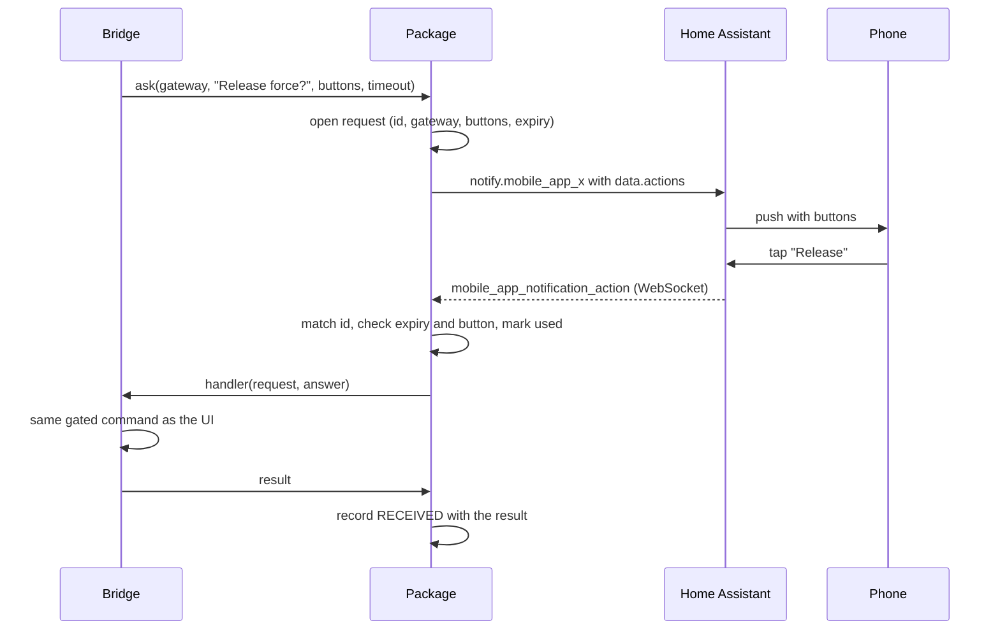

# Design: shared notifications with buttons

**Status:** approved by the owner, 2026-10-31. Tracked in
[direct-connect-bridge #374](https://github.com/david2069/franklinwh-direct-connect-bridge/issues/374).
Version 0.1.0 of this package is phase P1.

One small package that both FranklinWH bridges use to:
- find the phones and other targets that can receive notifications;
- send notifications with buttons;
- receive the taps;
- keep a record.

FWHAI's working system is the reference. Its behaviours are copied; its code is not, because it carries two of
everything after many rounds of changes.

## Decisions (owner, 2026-10-31)

1. **Shared code in a public repo and PyPI package**, `franklinwh-ha-notify`, pinned by both bridges.
2. **No special "critical action" tier.** Admin actions (restart a gateway, shut down the bridge) are ordinary
   buttons with the same gates as the UI, added when needed.
3. **Platform agnostic.** No per-platform button cap; the package sends the buttons and each phone shows what it can.
4. **The scheduler is the purpose of the feature**: a schedule step that asks, waits and acts on the answer. It
   doesn't have to be in the first two releases.
5. **Scope by need**: build what the bridges need now (below), leave the rest out.

## Where each project was on 2026-10-31

| Capability | Direct Connect bridge | Modbus bridge | FWHAI |
|---|---|---|---|
| Send to phones (`notify.*`) | Yes, three separate paths: engine triggers, scheduler, VPP monitor | Yes: scheduler and owner alerts | Yes: one sender, all devices at once |
| HA persistent notifications | Yes: status changes and critical alerts (outbox with retry) | Yes: critical alerts (outbox), bridge started/stopped | No |
| Saved target list, enable per target | Yes (`notify_devices`), test per device | No: target picked per schedule action | Yes, auto-adds `mobile_app_*`; no test per target |
| Buttons and receiving taps | No | No ("later feature") | Yes: WebSocket listener plus a webhook |
| Templates | No: fixed text; scheduler has `%sensor%` | No: fixed text; scheduler has `%sensor%` | Yes, but they miss most of the events actually sent |
| Record of what was sent | Partial: engine sends only, 2000 rows | No table; scheduler audit only | Yes: SENT/RECEIVED ledger, last 100 rows |
| Master switch | Two, and neither stops everything (DC #171) | Two toggles | One |

Both bridges use the same UI stack (Jinja, Alpine.js 3.14, Tailwind 3.4), so a settings card could be shared later.

## Scope against FWHAI: 10 built, 4 adapted, 9 left out

| FWHAI feature | Decision | What we build instead |
|---|---|---|
| Find notify targets in HA; mark which can show buttons | Build | Discovery per HA instance. Only `notify.mobile_app_*` can show buttons, and the list says so. |
| Saved targets with enable/disable | Build | One card per target with enable, disable and a test send, as Energipays does (DC #281). Friendly names. |
| Send with buttons (`data.actions`) | Build | Same payload shape, including FWHAI's iOS lesson: nothing nested under `data.push`. |
| WebSocket listener for taps | Build | The only receive path. Reconnect with back-off, one socket per HA instance in use. |
| Pending request, expiry, single use | Build | Stricter: every button needs a matching request (FWHAI lets Override and Skip through without one). |
| Response types, timeout, "if no reply" | Build | Yes/No, a choice of buttons, or a text reply. A real "No" (FWHAI's "No" behaves like no reply). Waiting is event-driven, not a 5-second database poll. |
| Answer passed to the next step | Build | The scheduler's next action can test the answer, like FWHAI's `notification.response_value`. |
| Templates with variables, reset to default | Build | One template for every event either bridge sends, each listing its own variables. The gateway name is always available (DC #361). |
| Global on/off | Build | One switch that really stops everything (DC #171). |
| Test round trip | Build | "Send test with buttons" on a target; shows sent, delivered, and the tap coming back. |
| SENT/RECEIVED ledger | Adapt | One record for every path, with gateway, request id and delivery count. Kept 30 days, not 100 rows. |
| Diagnostics joined with battery and pricing | Adapt | Each sent row can store the gateway's SoC, mode and power at that moment. No pricing join: neither bridge has a pricing engine. |
| Rate limit and cooldown after an ignored prompt | Adapt | One simple rule per event and gateway: a minimum gap between sends. (FWHAI's limit is stuck at 3/hour by a bug.) |
| Per-user routing | Adapt | Waits for user roles; the target record is ready for it. |
| Webhook callback, `rest_command` YAML, "View HA Blueprint", setup audit, callback-path test | Leave out | All exist only for the webhook, which failed silently in FWHAI: pushes delivered, no tap was ever recorded. |
| E2E pipeline map | Leave out | The test round trip shows the same thing with real results. |
| Smart Dispatch strategies (Interactive / Autonomous / Muted) | Leave out | Each feature decides whether it asks. |
| Price triggers (spike, negative export, demand charge, export bonus, earnings) | Leave out | FWHAI's pricing engine. The bridges have their own event lists. |
| Lookahead (T-30) prompts | Leave out | Pricing feature. |
| V1 and V2 button names | Leave out | One name set from the start. |
| Buttons that only write a log line (Spike Hold, Remind in 30 min) | Leave out | Every button does something real. |
| Legacy single target, unused trigger list, unused routing field | Leave out | One target list. |
| Certificate expiry notice | Leave out | The bridges don't manage TLS certificates. |

## The package and the bridges

| Package (shared) | Each bridge (its own) |
|---|---|
| Target discovery, button-capable flag | What each button does (its handlers) |
| Sending, with a delivery count per target | When to notify (its events, its scheduler) |
| WebSocket listener, reconnect, one per HA instance | Settings UI |
| Requests: id, expiry, single use, allowed buttons | Gates: writes, confirm, gateway checks, as the UI already applies |
| Response wait, timeout | Storage (the ledger lives in the bridge's own SQLite) |
| Templates and variable rendering | |
| Ledger schema and writer | |

No FranklinWH device code lives in the package.

## A tap, end to end

## The button contract (shared by both bridges)

- A button's action id is `FWH_<VERB>_<request id>`: the request id is 16 hex characters and the verb is upper case.
  Putting the request id inside the action id is what makes it platform agnostic. Every Companion app echoes
  `action` back; other data fields come back differently on iOS and Android.
- Verbs: `YES`, `NO`, `CHOICE_n`, `REPLY` (a text reply), `RELEASE`, `ACK`, `CONFIRM`, `TEST`. A bridge may add
  verbs; HA automations can listen for any of them on either bridge.
- Buttons without the `FWH_` prefix (Snooze and similar, added by the phone) are ignored.
- A tap resolves as **accepted**, **unknown** (never issued, or lost in a restart), **expired**, **used** or
  **not-allowed** (a button the request didn't offer). Only accepted taps reach the bridge; every outcome is recorded.

## Safety

- **No open route.** Taps arrive only over the bridge's own authenticated WebSocket to HA. Nothing on the bridge
  accepts an unauthenticated call.
- **Every tap needs its request.** Unknown, expired or already-used ids do nothing and are recorded with the reason.
- **Same gates as the UI.** A button calls the command the UI would, with the same checks, on the gateway named in
  the request.
- Requests live in memory. Expiries are minutes, so a restart losing them is acceptable: a tap after a restart
  resolves as `unknown` and says so.

## First buttons in the Direct Connect bridge

- Interrupted or orphaned force: **Release**.
- Critical alert: **Acknowledge**, which also clears the HA notification.
- aGate moved: **Re-discover**.
- Scheduler: **"Ask before continuing"**, with Yes/No or choices, a timeout, and what to do with no reply (P4).
- Admin actions (restart gateway, shut down bridge): ordinary buttons, added when needed.

## Plan

| Phase | Work | Gate |
|---|---|---|
| P0 | Approve this design; the Modbus bridge session checks the contract against its scheduler. | Owner approval (done 2026-10-31) |
| P1 | This package, 0.1.0: discovery, sending, listener, requests, response wait, templates, ledger. Tested against a fake HA, including reconnect, expiry, replay and a "No" tap. | Its own CI; published to PyPI (done; awaits PyPI trusted publisher) |
| P2 | Direct Connect: the three send paths become one through the package, with one master switch (#171), the gateway in every message (#361), every send recorded, the target card (#281) and templates. No buttons yet. | G0, G1 on the HAOS VM |
| P3 | Direct Connect: Release, Acknowledge, Re-discover, and the test round trip on each target. | G0, G1; G2 on the real aGate for Release, with the owner present |
| P4 | The scheduler's "Ask before continuing" step. The Modbus bridge adopts the package for its scheduler too, in its own repo. | G0, G1; the Modbus bridge's own gates |

Direct Connect issues this closes or advances: #374, #281, #171, #361, #172, #180, #402.

## FWHAI defects this design avoids

Found while reading FWHAI 0.6.80 (2026-10-31); listed so they aren't copied:

- "No" sends `FWH_SKIP`, which deletes the pending request without recording an answer, so it behaves like no reply.
- Override, Skip and Spike Hold run without a matching request, on a route exempt from authentication.
- The actionable-step branch reads `payload.action`, so webhook taps (which send `action_id`) never match.
- Templates don't cover most of the event keys the engine actually sends.
- The rate limit reads a column that doesn't exist, so it is always 3 per hour.
- The automation builder waits by polling the database every 5 seconds.
